# SANT·SIM — Simulador de vuelo de drones para el estudio de los sistemas aéreos no tripulados

**▶ Abrir el simulador: https://nutshell-electronica.github.io/simulador-drones/**

> 🌐 [English version → README_EN.md](README_EN.md)

Simulador de drones que funciona en el navegador, sin instalar nada y sin conexión a internet. Está pensado para **aprender cómo se comporta un dron y por qué**: no solo se vuela, también se ven la potencia, la batería, el viento, la señal de radio, el GNSS y la normativa europea mientras ocurre.

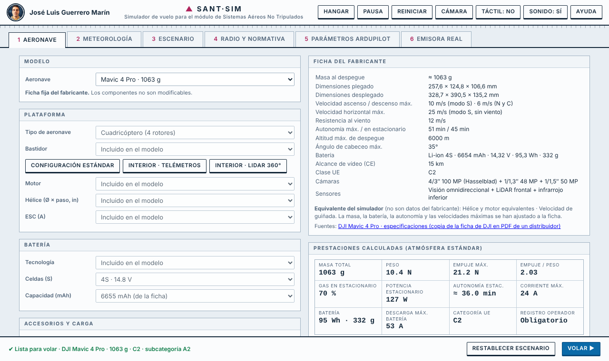

## Qué se puede hacer

**Diseñar la aeronave (Hangar)**
- Cuadricóptero, tricóptero, hexacóptero, octocóptero, helicóptero y ala fija.
- Elegir bastidor, motor, hélice, ESC, batería (tecnología, celdas y capacidad), cámara FPV, GNSS, telémetros, LiDAR, paracaídas y carga útil. El simulador calcula empuje, relación empuje/peso, gas en estacionario, autonomía y corriente, y avisa de combinaciones peligrosas.
- **Drones comerciales con ficha del fabricante**: Tello, DJI Mini 4 Pro, Mini 5 Pro, Air 3S, Mavic 4 Pro, Avata 2, Matrice 350 RTK y eBee X (ala fija). Se cargan con los datos publicados y no se pueden modificar (salvo la carga útil del Matrice 350 RTK). Cada ficha indica qué es dato del fabricante, qué es estimado y de dónde sale.

**Volar en condiciones realistas**
- Física de empuje, batería, viento (rachas y turbulencia), densidad del aire y temperatura.
- Modos GPS y ATTI, regreso a casa (RTH), pérdida de enlace, batería baja, fallo de motor, autorrotación y paracaídas.
- Radio de mando y de vídeo con potencia, antena e interferencias; GNSS con número de satélites y precisión.
- **Instrumento de viento** tipo aviónica en pantalla: flecha de viento relativa al morro del dron sobre una rosa de rumbos, velocidad (m/s y km/h), procedencia, componentes de cara/cola y de costado, y ráfagas (se puede ocultar en Meteorología).
- Hora y lugar del vuelo: posición del Sol, brújula y deslumbramiento.
- Aves, cometas y personas como obstáculos y riesgos.

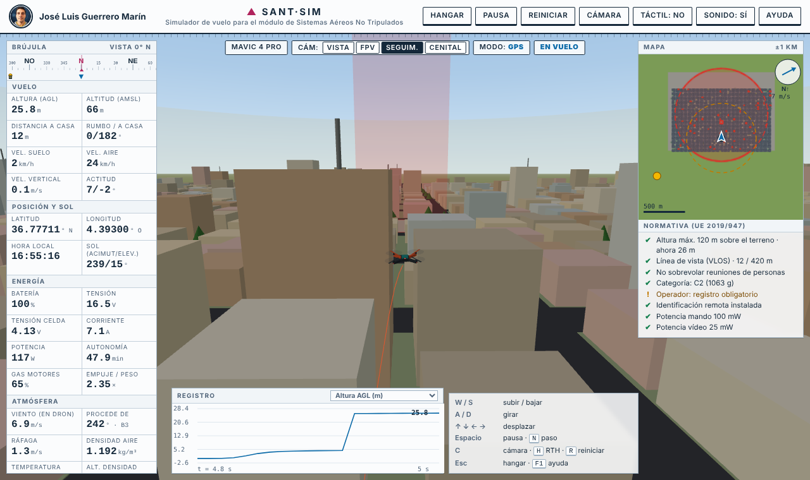

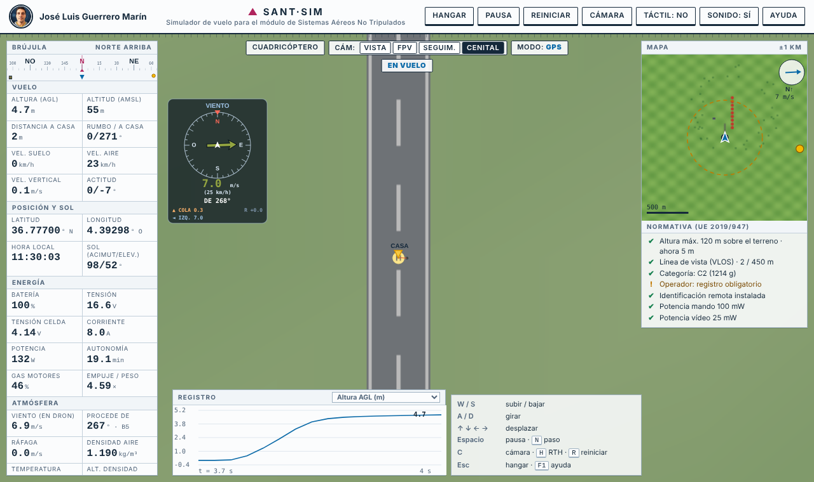

**Escenarios**
- Campo, ciudad, bosque, montaña, costa, aeropuerto, nave industrial (interior, sin GNSS) y barrio residencial con despegue desde una azotea.
- **Lugares reconocibles de Málaga** (maquetas simplificadas, con las coordenadas GPS de partida correspondientes):
  - **Puerto de Málaga · Muelle Uno**, con La Farola al fondo, yates, un crucero, el Cubo del Pompidou, el Palmeral, la Catedral y Gibralfaro.
  - **Guadalhorce · pasarela de madera** del Paraje Natural, con río, lagunas, dunas y pinar del Arraijanal, el mar al sur y la zona UAS del aeropuerto al oeste.
- **Escenarios de fantasía** (estilizados, con nombres propios):
  - **Tierra de cubos**: mundo de bloques de 24 m con llanuras, colinas y montañas nevadas, ríos y un lago, árboles cuadrados, una aldea, una pirámide escalonada, pilares de piedra y bloques flotantes. El terreno sube en escalones y el agua es amerizaje.
  - **Fortaleza de lava**: castillo oscuro con torreón central, torreones de esquina, murallas almenadas y puerta con puente sobre un foso de lava, rodeado de ríos y lagos de lava. Caer a la lava es siniestro total.
- En interior, sensores ToF, LiDAR 2D y flujo óptico.

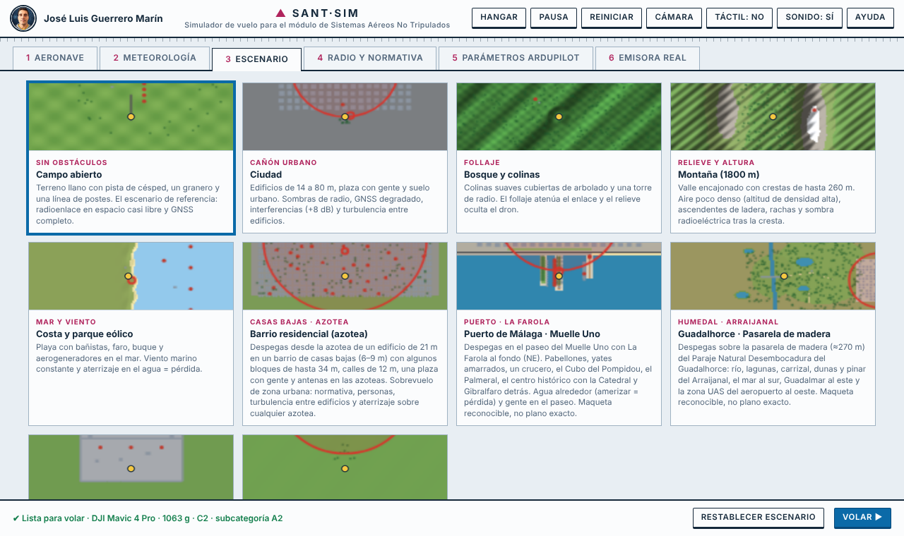

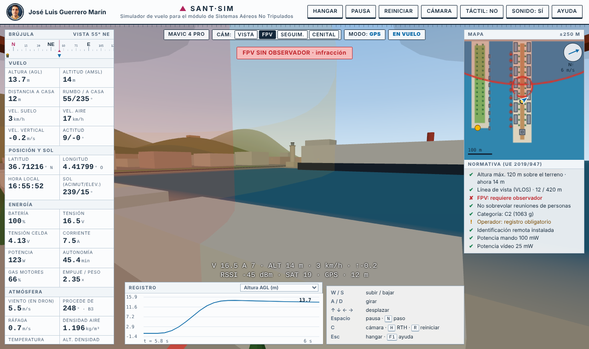

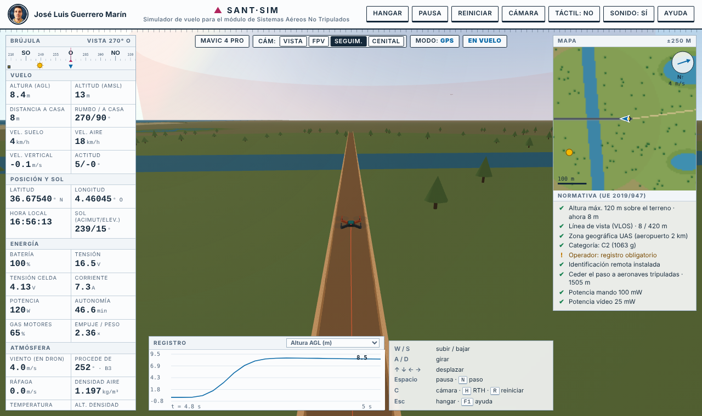

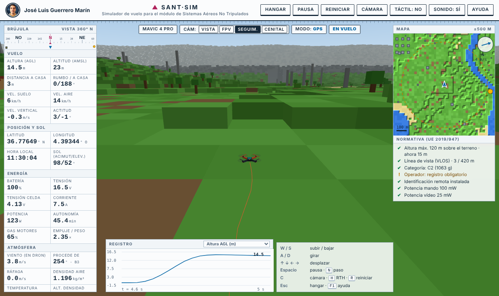

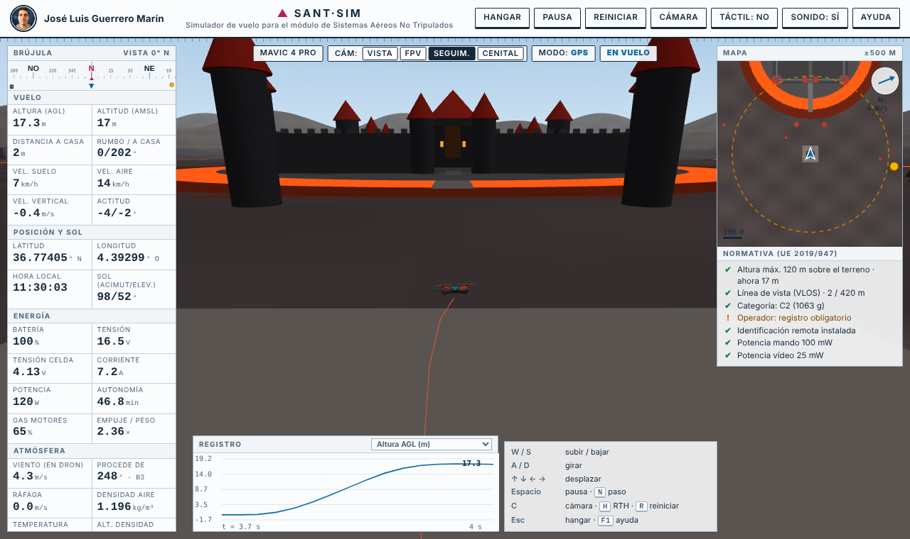

**Modo competición** (opcional, en cualquier escenario): recorrido de **1 a 20 aros** a distintas alturas, con cronómetro.
- El siguiente aro se ilumina en **amarillo**, los pendientes son naranjas y los superados se ponen en **verde**. Cada aro lleva su número y un poste hasta el suelo para valorar la altura.
- Al pasar bien por un aro suena un *clink* (tipo anillo de Sonic), la pantalla da un destello verde y el aro hace un estallido; al completar el recorrido suena una fanfarria y el destello es dorado.
- Flechas en pantalla hacia el siguiente aro, distancia y diferencia de altura, aros marcados en el minimapa, tiempos parciales y **mejor tiempo guardado** por escenario y número de aros.
- **El slider fija la dificultad**: de *muy fácil* (1–3 aros) a *experto* (18–20). A más aros, aros más pequeños (de unos 8 m a 4 m de diámetro), más separados y a alturas más distintas. Adaptado a multirrotores, ala fija y a la nave interior.
- Cada vuelo nuevo genera un recorrido distinto; **Reiniciar** repite el mismo para intentar mejorar el tiempo.

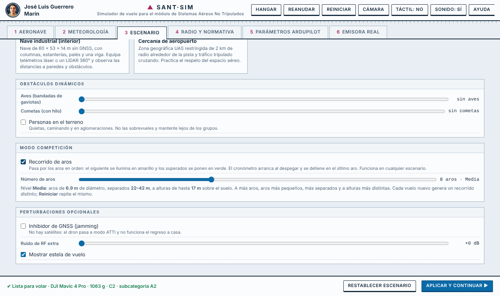

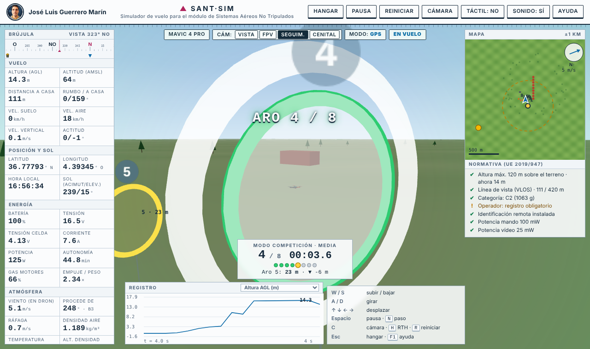

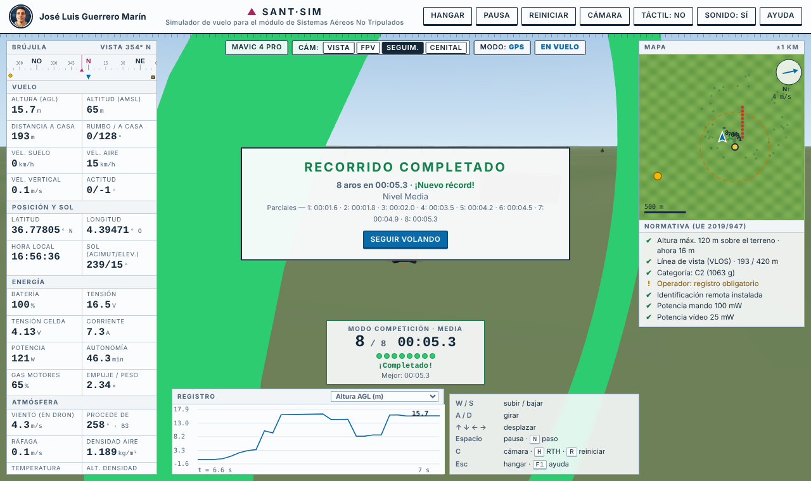

**Cuatro cámaras**: a la vista (VLOS), FPV, seguimiento y cenital, con mapa y HUD.

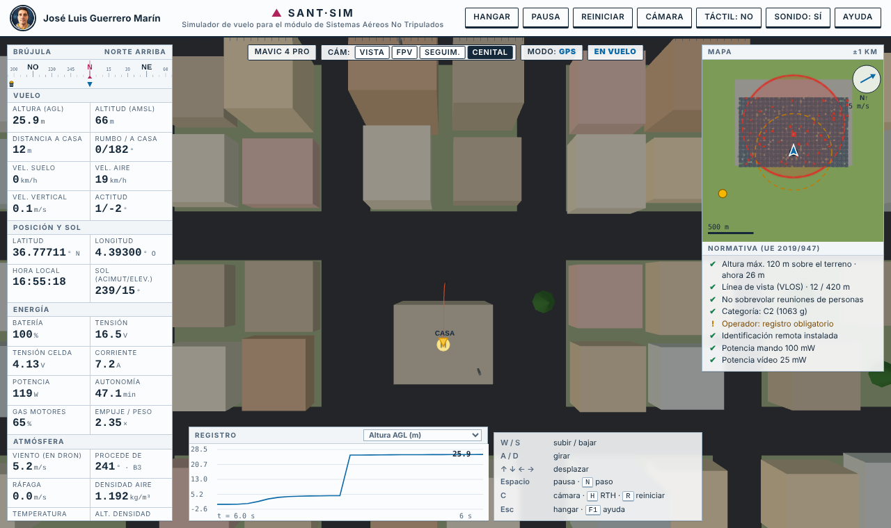

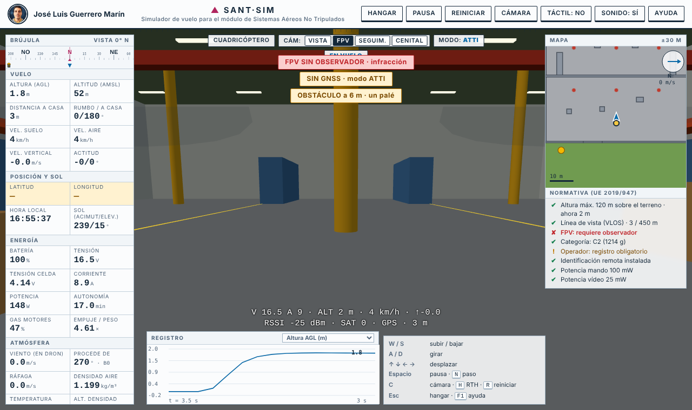

**Normativa europea en vivo** (Reglamento UE 2019/947): altura máxima, línea de vista, vuelo FPV con observador, sobrevuelo de personas, categoría y subcategoría según masa, registro de operador e identificación remota.

**Tail-sitter VTOL (ArduPilot Quadplane)**: seis variantes de ala volante que despegan y aterrizan sobre la cola y pasan a vuelo adelante en el aire.

| Variante | `Q_TAILSIT_ENABLE` | `Q_FRAME_CLASS` | Motores en vuelo adelante |
|---|---|---|---|
| Monomotor 3D (con superficies) | 1 | 10 Single/Dual | 1 |
| Bimotor (dos motores fijos + elevones) | 1 | 10 Single/Dual | 2 |
| Bimotor vectorial (servos de inclinación) | 1 | 10 Single/Dual | 2 |
| Tricóptero tail-sitter | 1 | 7 Tri | 2 (`Q_TAILSIT_MOTMX`) |
| Cuatro motores con superficies | 1 | 1 Quad | 2 (`Q_TAILSIT_MOTMX`) |
| Cuatro motores sin superficies | 2 | 1 Quad | 4 |

- **V** (o el botón de fase en la barra superior) cambia entre VTOL y vuelo adelante; el regreso a casa (RTH) convierte a VTOL cerca de casa y aterriza en vertical.
- En el hangar cada variante muestra su configuración ArduPilot (`Q_ENABLE`, `Q_FRAME_CLASS`, `Q_TAILSIT_*`, salidas) y permite descargar un `.param` orientativo.
- La pestaña de parámetros reconoce `Q_TAILSIT_ANGLE`, `ANG_VT`, `RAT_FW`, `RAT_VT`, `INPUT`, `Q_ANGLE_MAX`, `Q_WP_SPEED`, `Q_LAND_SPEED`, `Q_RTL_ALT` y propone cambiar a la variante que corresponda al archivo.

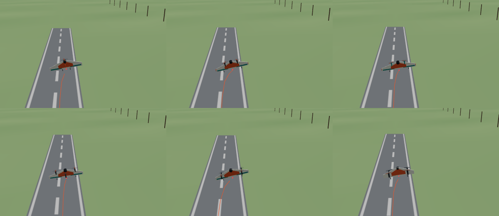

**Herramientas de estudio**
- Registro de vuelo con gráficas y exportación a CSV.
- Pausa, avance paso a paso e inspector de valores.
- Parámetros de ArduPilot: se puede cargar un archivo `.param` y el simulador aplica los que tienen efecto (de forma aproximada, no es un SITL).
- Sonido sintetizado de motores, viento, lluvia, avisos y aros; se silencia al salir al hangar.
- **Idioma español / inglés**: selector con banderas (ES · EN) en la esquina superior derecha. Traduce toda la interfaz, los avisos, los textos de los gráficos y el `.param` descargable; se recuerda la elección y, la primera vez, se elige según el idioma del navegador.

## Cómo se controla

| Dispositivo | Uso |
|---|---|
| Teclado | W/S altura · A/D giro · flechas desplazamiento · Espacio pausa · C cámara · H regreso a casa · Q GPS/ATTI · F1 ayuda |
| Táctil | Palancas en pantalla (móvil o tableta) |
| **Emisora real** | Cualquier radio que el navegador vea como mando (cable USB en modo *Joystick HID*, cable de simulador o dongle). Perfiles AETR, TAER y mando de consola, con detección automática de ejes e interruptores. Incluye guía para RadioMaster TX16S con dongle Spektrum |

## Uso en el aula

- Un solo archivo HTML: se puede repartir por USB o abrir directamente desde esta página.
- Cada alumno puede diseñar su aeronave, volarla y comparar lo que calcula el simulador con lo que ocurre en vuelo.
- Sirve para prácticas de energía y autonomía, efecto del viento, pérdida de enlace, normativa, volar sin GNSS o por interior.

## Limitaciones

- Tail-sitter: aerodinámica de la transición simplificada; la entrada a vuelo adelante exige altura mínima (15 m) y velocidad suficiente, a diferencia de ArduPilot; el ajuste fino (`Q_TAILSIT_VHGAIN`, `GSCMSK`…) no se emula. Los `.param` generados son orientativos.
- Es un simulador didáctico, no un SITL ni un simulador certificado: la dinámica es simplificada y los parámetros de ArduPilot se interpretan de forma aproximada.
- En los modelos comerciales, el motor y la hélice equivalentes están estimados (el fabricante no los publica); masa, autonomía y velocidades se ajustan a la ficha.
- La emisora real se ha probado por cable con una radio EdgeTX y con el dongle inalámbrico (Spektrum) en casa; en otro entorno (aula) puede requerir revisar la configuración. Conviene revisar ejes e inversiones con cada radio.

## Archivos

- `index.html` — el simulador (autocontenido).
- `SANT_SIM_fuentes.zip` — código fuente por módulos y `build.sh` para regenerarlo.

---

Autoría: José Luis Guerrero Marín.
Usa [three.js](https://threejs.org/) (licencia MIT), incluido en el archivo.
