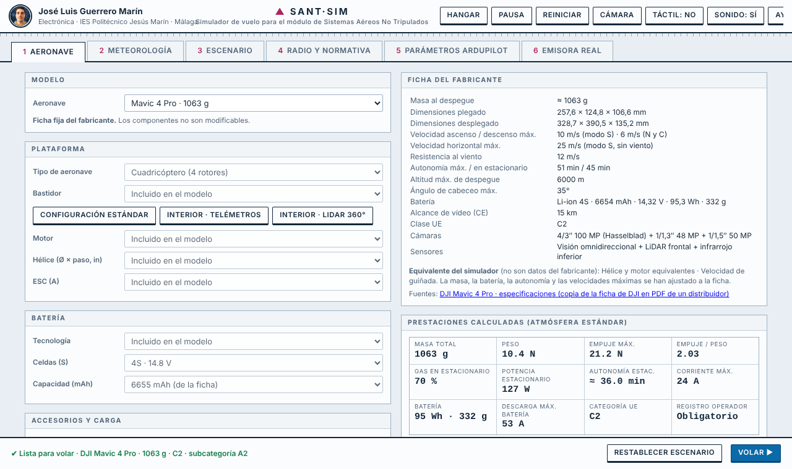
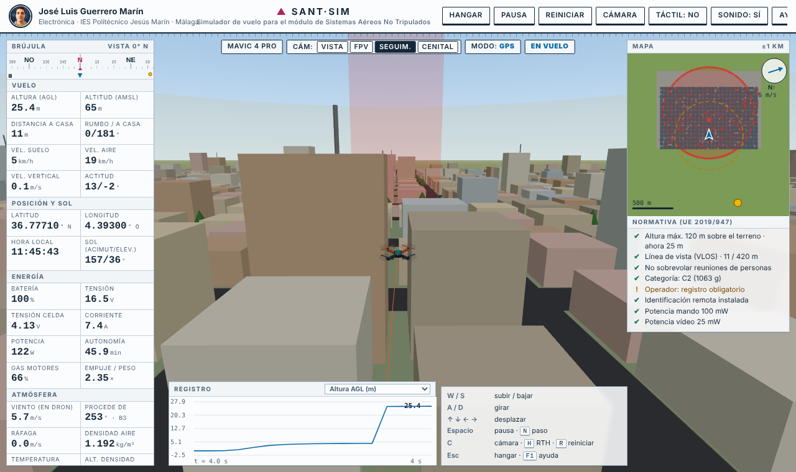
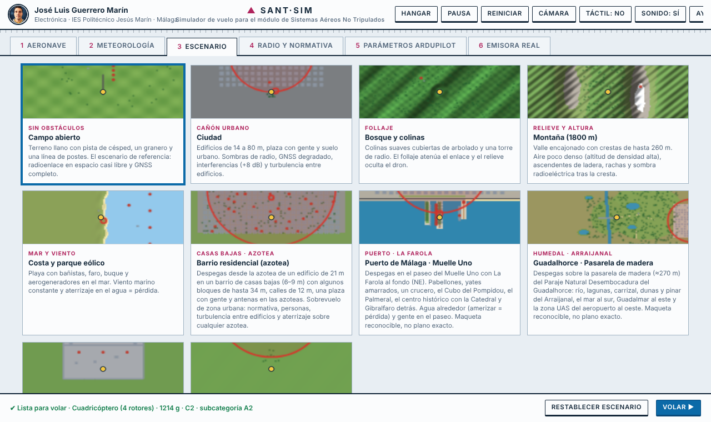
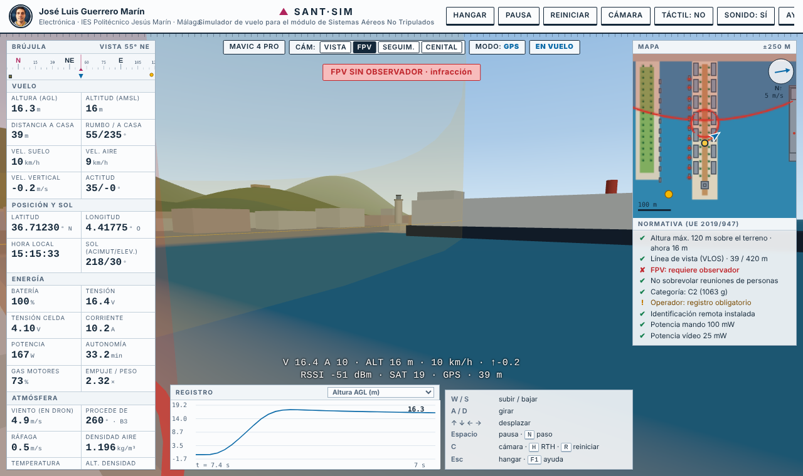
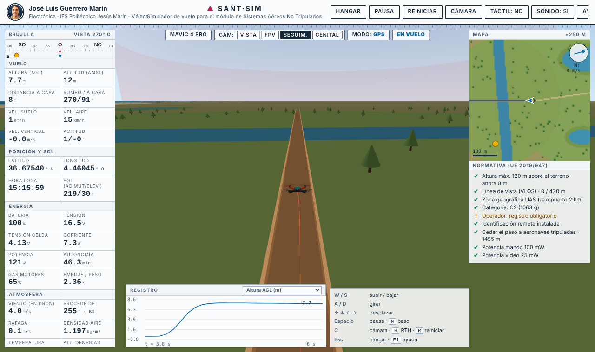
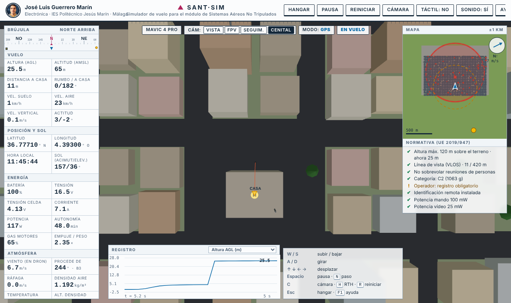
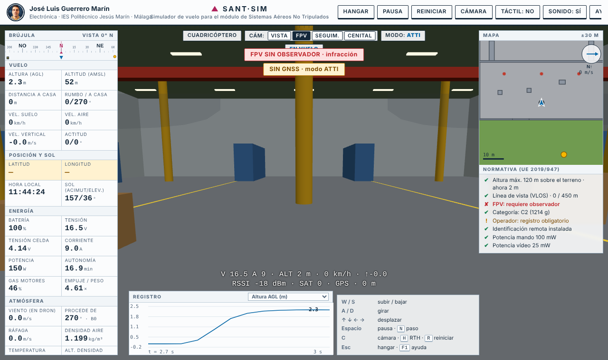

# SANT·SIM — Simulador de vuelo de drones para el estudio de los sistemas aéreos no tripulados

**▶ Abrir el simulador: https://nutshell-electronica.github.io/simulador-drones/**

Simulador de drones que funciona en el navegador, sin instalar nada y sin conexión a internet. Está pensado para **aprender cómo se comporta un dron y por qué**: no solo se vuela, también se ven la potencia, la batería, el viento, la señal de radio, el GNSS y la normativa europea mientras ocurre.

## Qué se puede hacer

**Diseñar la aeronave (Hangar)**
- Cuadricóptero, tricóptero, hexacóptero, octocóptero, helicóptero y ala fija.
- Elegir bastidor, motor, hélice, ESC, batería (tecnología, celdas y capacidad), cámara FPV, GNSS, telémetros, LiDAR, paracaídas y carga útil. El simulador calcula empuje, relación empuje/peso, gas en estacionario, autonomía y corriente, y avisa de combinaciones peligrosas.
- **Drones comerciales con ficha del fabricante**: Tello, DJI Mini 4 Pro, Mini 5 Pro, Air 3S, Mavic 4 Pro, Avata 2, Matrice 350 RTK y eBee X (ala fija). Se cargan con los datos publicados y no se pueden modificar (salvo la carga útil del Matrice 350 RTK). Cada ficha indica qué es dato del fabricante, qué es estimado y de dónde sale.

**Volar en condiciones realistas**
- Física de empuje, batería, viento (rachas y turbulencia), densidad del aire y temperatura.
- Modos GPS y ATTI, regreso a casa (RTH), pérdida de enlace, batería baja, fallo de motor, autorrotación y paracaídas.
- Radio de mando y de vídeo con potencia, antena e interferencias; GNSS con número de satélites y precisión.
- Hora y lugar del vuelo: posición del Sol, brújula y deslumbramiento.
- Aves, cometas y personas como obstáculos y riesgos.

**Escenarios**
- Campo, ciudad, bosque, montaña, costa, aeropuerto, nave industrial (interior, sin GNSS) y barrio residencial con despegue desde una azotea.
- **Lugares reconocibles de Málaga** (maquetas simplificadas, con las coordenadas GPS de partida correspondientes):
  - **Puerto de Málaga · Muelle Uno**, con La Farola al fondo, yates, un crucero, el Cubo del Pompidou, el Palmeral, la Catedral y Gibralfaro.
  - **Guadalhorce · pasarela de madera** del Paraje Natural, con río, lagunas, dunas y pinar del Arraijanal, el mar al sur y la zona UAS del aeropuerto al oeste.
- En interior, sensores ToF, LiDAR 2D y flujo óptico.

**Cuatro cámaras**: a la vista (VLOS), FPV, seguimiento y cenital, con mapa y HUD.

**Normativa europea en vivo** (Reglamento UE 2019/947): altura máxima, línea de vista, vuelo FPV con observador, sobrevuelo de personas, categoría y subcategoría según masa, registro de operador e identificación remota.

**Herramientas de estudio**
- Registro de vuelo con gráficas y exportación a CSV.
- Pausa, avance paso a paso e inspector de valores.
- Parámetros de ArduPilot: se puede cargar un archivo `.param` y el simulador aplica los que tienen efecto (de forma aproximada, no es un SITL).
- Sonido sintetizado de motores y avisos.

## Cómo se controla

| Dispositivo | Uso |
|---|---|
| Teclado | W/S altura · A/D giro · flechas desplazamiento · Espacio pausa · C cámara · H regreso a casa · Q GPS/ATTI · F1 ayuda |
| Táctil | Palancas en pantalla (móvil o tableta) |
| **Emisora real** | Cualquier radio que el navegador vea como mando (cable USB en modo *Joystick HID*, cable de simulador o dongle). Perfiles AETR, TAER y mando de consola, con detección automática de ejes e interruptores. Incluye guía para RadioMaster TX16S con dongle Spektrum |

## Uso en el aula

- Un solo archivo HTML: se puede repartir por USB o abrir directamente desde esta página.
- Cada alumno puede diseñar su aeronave, volarla y comparar lo que calcula el simulador con lo que ocurre en vuelo.
- Sirve para prácticas de energía y autonomía, efecto del viento, pérdida de enlace, normativa, volar sin GNSS o por interior.

## Limitaciones

- Es un simulador didáctico, no un SITL ni un simulador certificado: la dinámica es simplificada y los parámetros de ArduPilot se interpretan de forma aproximada.
- En los modelos comerciales, el motor y la hélice equivalentes están estimados (el fabricante no los publica); masa, autonomía y velocidades se ajustan a la ficha.
- La emisora real se ha probado con un mando simulado; conviene revisar ejes e inversiones con cada radio.

## Archivos

- `index.html` — el simulador (autocontenido).
- `SANT_SIM_fuentes.zip` — código fuente por módulos y `build.sh` para regenerarlo.

---

Autoría: José Luis Guerrero Marín · Electrónica (IES Politécnico Jesús Marín, Málaga).
Usa [three.js](https://threejs.org/) (licencia MIT), incluido en el archivo.
