# SANT·SIM — Drone flight simulator for studying unmanned aircraft systems

**▶ Open the simulator: https://nutshell-electronica.github.io/simulador-drones/**

> 🌐 [Versión en español → README.md](README.md)

> Note: the simulator interface itself is currently in Spanish; this document describes it in English.

A drone simulator that runs in the browser, with nothing to install and no internet connection needed. It is designed to **learn how a drone behaves and why**: you don't just fly it, you also see power, battery, wind, radio signal, GNSS and European regulations while it happens.

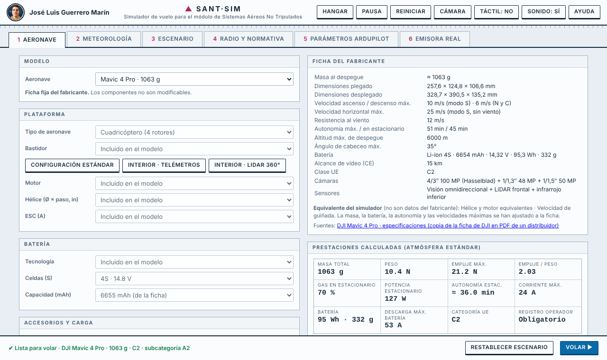

## What you can do

**Design the aircraft (Hangar)**
- Quadcopter, tricopter, hexacopter, octocopter, helicopter and fixed wing.
- Choose frame, motor, propeller, ESC, battery (chemistry, cell count and capacity), FPV camera, GNSS, rangefinders, LiDAR, parachute and payload. The simulator computes thrust, thrust-to-weight ratio, hover throttle, endurance and current, and warns about dangerous combinations.
- **Commercial drones with manufacturer data sheets**: Tello, DJI Mini 4 Pro, Mini 5 Pro, Air 3S, Mavic 4 Pro, Avata 2, Matrice 350 RTK and eBee X (fixed wing). They load with published data and cannot be modified (except the Matrice 350 RTK payload). Each sheet states what is manufacturer data, what is estimated and where it comes from.

**Fly under realistic conditions**
- Thrust, battery, wind (gusts and turbulence), air density and temperature physics.
- GPS and ATTI modes, return-to-home (RTH), link loss, low battery, motor failure, autorotation and parachute.
- Control and video radio links with power, antenna and interference; GNSS with satellite count and accuracy.
- **On-screen avionics-style wind instrument**: wind arrow relative to the drone's nose over a compass rose, speed (m/s and km/h), direction it comes from, head/tail and crosswind components, and gusts (can be hidden in the Weather tab).
- Time and place of the flight: Sun position, compass and glare.
- Birds, kites and people as obstacles and hazards.

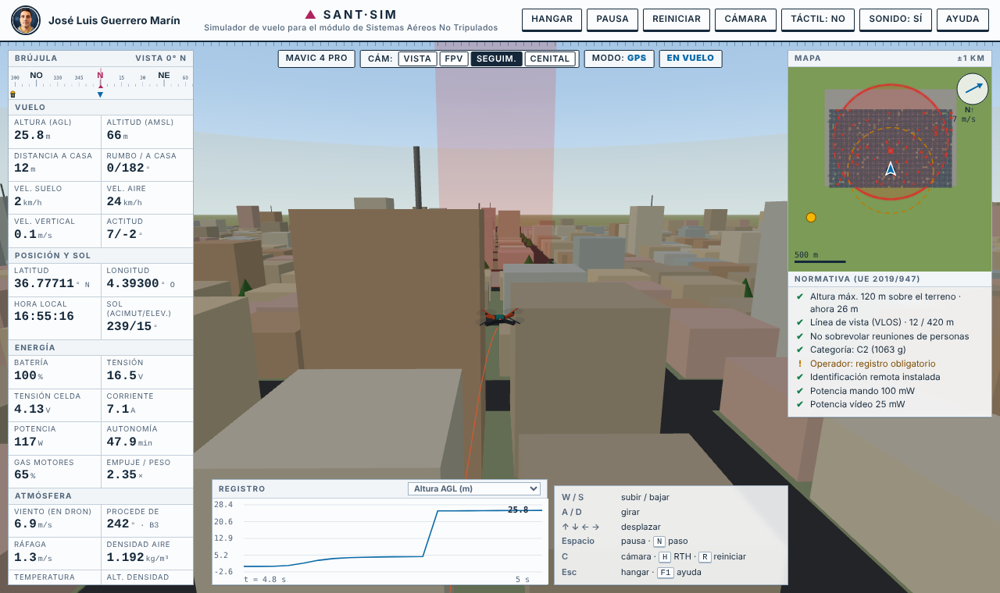

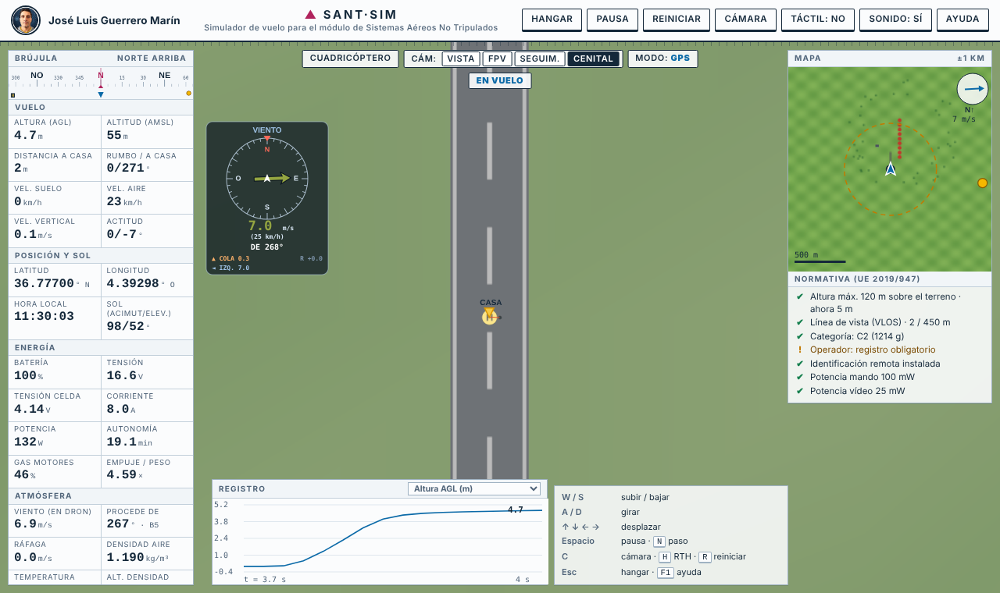

**Scenarios**
- Countryside, city, forest, mountain, coast, airport, industrial hall (indoor, no GNSS) and residential neighbourhood with a rooftop take-off.
- **Recognisable places in Málaga** (simplified models, with the matching starting GPS coordinates):
  - **Port of Málaga · Muelle Uno**, with La Farola in the background, yachts, a cruise ship, the Pompidou Cube, the Palmeral, the Cathedral and Gibralfaro.
  - **Guadalhorce · wooden boardwalk** in the Nature Reserve, with river, lagoons, dunes and the Arraijanal pine forest, the sea to the south and the airport UAS zone to the west.
- **Fantasy scenarios** (stylised, with their own names):
  - **Land of Cubes**: a 24 m block world with plains, hills and snowy mountains, rivers and a lake, square trees, a village, a stepped pyramid, stone pillars and floating blocks. Terrain rises in steps and water means a splashdown.
  - **Lava Fortress**: a dark castle with a central keep, corner towers, crenellated walls and a gate with a bridge over a lava moat, surrounded by lava rivers and lakes. Falling into the lava is a total loss.
- Indoors: ToF sensors, 2D LiDAR and optical flow.

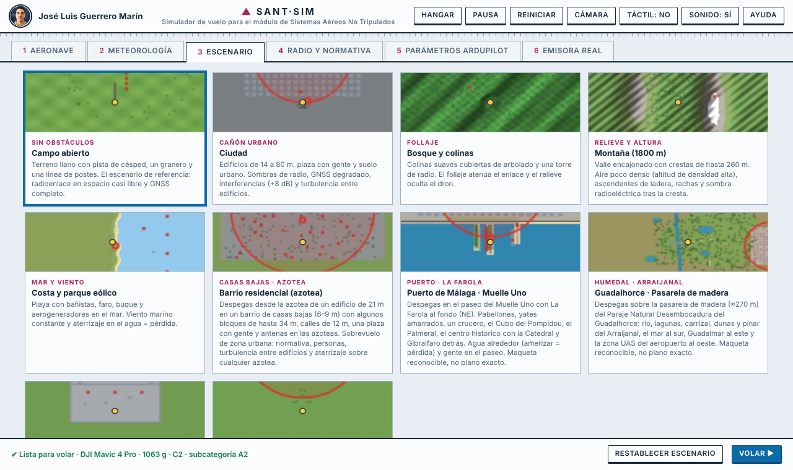

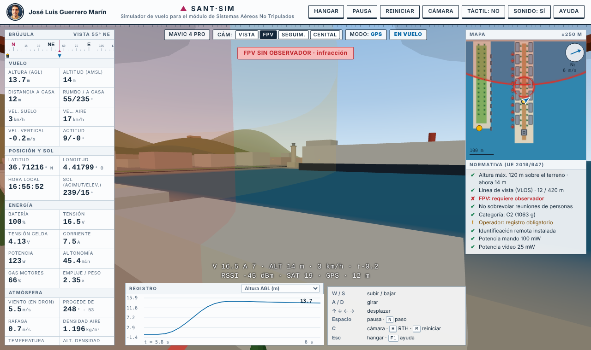

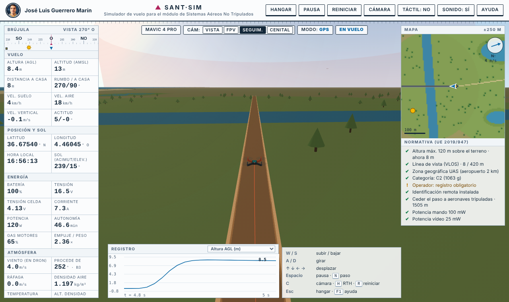

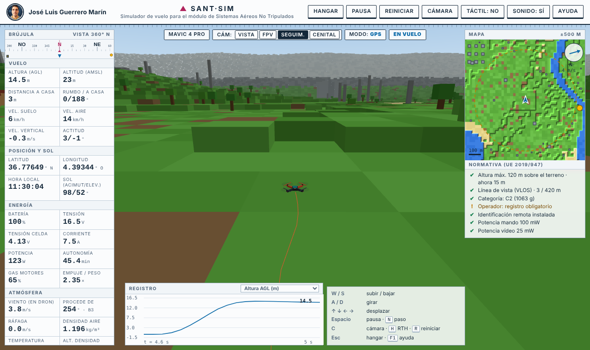

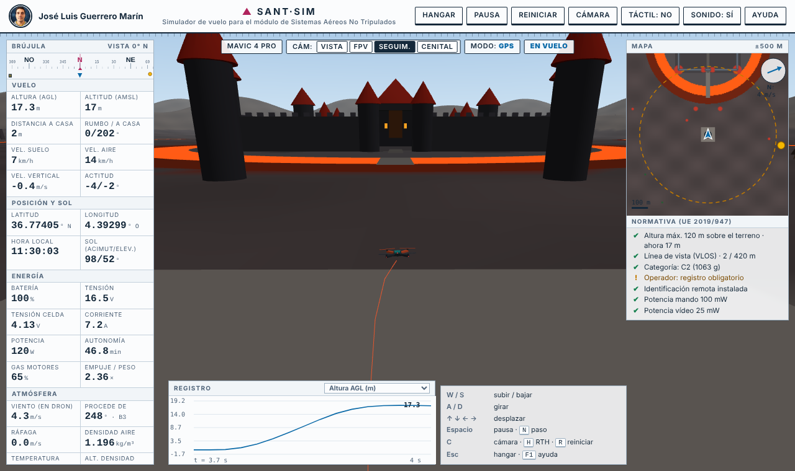

**Competition mode** (optional, in any scenario): a course of **1 to 20 rings** at different heights, with a timer.
- The next ring lights up **yellow**, pending ones are orange and cleared ones turn **green**. Each ring shows its number and a pole down to the ground to judge height.
- Flying through a ring plays a *clink* (Sonic-ring style), flashes the screen green and bursts the ring; completing the course plays a fanfare and a gold flash.
- On-screen arrows to the next ring, distance and height difference, rings shown on the minimap, split times and **best time saved** per scenario and ring count.
- **The slider sets the difficulty**: from *very easy* (1–3 rings) to *expert* (18–20). More rings means smaller rings (about 8 m down to 4 m in diameter), farther apart and at more varied heights. Adapted to multirotors, fixed wing and the indoor hall.
- Every new flight generates a different course; **Restart** repeats the same one to try to beat your time.

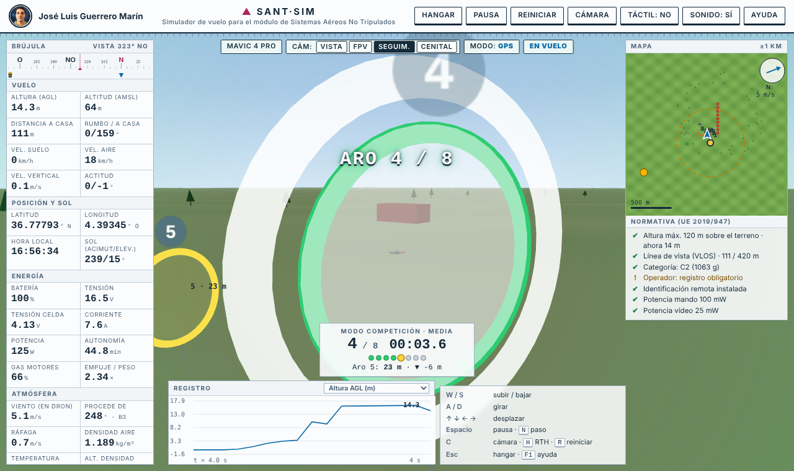

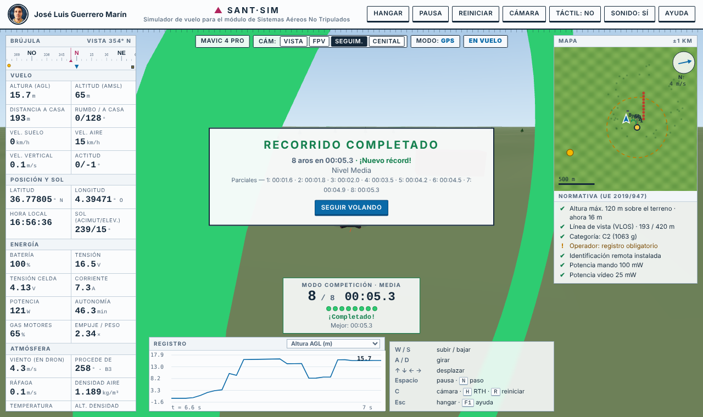

**Four cameras**: line of sight (VLOS), FPV, chase and top-down, with map and HUD.

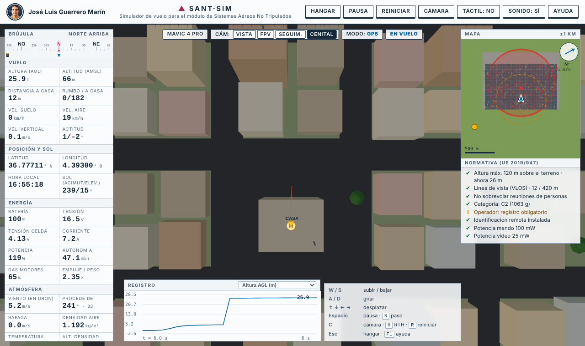

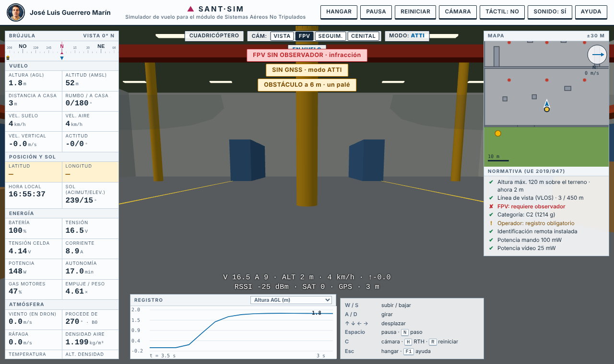

**Live European regulations** (Regulation EU 2019/947): maximum height, line of sight, FPV flight with observer, flight over people, category and subcategory by mass, operator registration and remote identification.

**VTOL tail-sitter (ArduPilot Quadplane)**: six flying-wing variants that take off and land on their tail and transition to forward flight in the air.

| Variant | `Q_TAILSIT_ENABLE` | `Q_FRAME_CLASS` | Motors in forward flight |
|---|---|---|---|
| Single motor 3D (with control surfaces) | 1 | 10 Single/Dual | 1 |
| Twin motor (two fixed motors + elevons) | 1 | 10 Single/Dual | 2 |
| Vectored twin (tilt servos) | 1 | 10 Single/Dual | 2 |
| Tri-copter tail-sitter | 1 | 7 Tri | 2 (`Q_TAILSIT_MOTMX`) |
| Four motors with control surfaces | 1 | 1 Quad | 2 (`Q_TAILSIT_MOTMX`) |
| Four motors without control surfaces | 2 | 1 Quad | 4 |

- **V** (or the phase button in the top bar) switches between VTOL and forward flight; return-to-home (RTH) converts to VTOL near home and lands vertically.
- In the hangar each variant shows its ArduPilot configuration (`Q_ENABLE`, `Q_FRAME_CLASS`, `Q_TAILSIT_*`, outputs) and lets you download an indicative `.param` file.
- The parameters tab recognises `Q_TAILSIT_ANGLE`, `ANG_VT`, `RAT_FW`, `RAT_VT`, `INPUT`, `Q_ANGLE_MAX`, `Q_WP_SPEED`, `Q_LAND_SPEED`, `Q_RTL_ALT` and offers to switch to the variant matching the file.

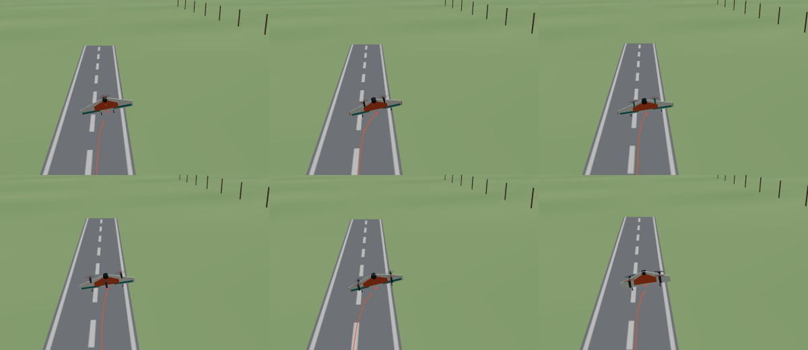

**Study tools**
- Flight log with charts and CSV export.
- Pause, single-step and a value inspector.
- ArduPilot parameters: load a `.param` file and the simulator applies those that have an effect (approximately; it is not an SITL).
- Synthesised sound for motors, wind, rain, warnings and rings; muted when returning to the hangar.

## Controls

| Device | Use |
|---|---|
| Keyboard | W/S altitude · A/D yaw · arrow keys move · Space pause · C camera · H return home · Q GPS/ATTI · V tail-sitter phase · F1 help |
| Touch | On-screen sticks (phone or tablet) |
| **Real transmitter** | Any radio the browser sees as a gamepad (USB cable in *Joystick HID* mode, simulator cable or dongle). AETR, TAER and console-gamepad profiles, with automatic axis and switch detection. Includes a guide for the RadioMaster TX16S with a Spektrum dongle |

## Classroom use

- A single HTML file: it can be handed out on a USB stick or opened straight from this page.
- Each student can design an aircraft, fly it and compare what the simulator computes with what happens in flight.
- Useful for exercises on energy and endurance, wind effects, link loss, regulations, and flying without GNSS or indoors.

## Limitations

- Tail-sitter: the transition aerodynamics are simplified; entering forward flight requires a minimum height (15 m) and enough airspeed, unlike ArduPilot; fine tuning (`Q_TAILSIT_VHGAIN`, `GSCMSK`…) is not emulated. The generated `.param` files are indicative only.
- It is a teaching simulator, not an SITL nor a certified simulator: the dynamics are simplified and ArduPilot parameters are interpreted approximately.
- For commercial models, the equivalent motor and propeller are estimated (the manufacturer does not publish them); mass, endurance and speeds are fitted to the data sheet.
- The real transmitter has been tested over cable with an EdgeTX radio and with the wireless dongle (Spektrum) at home; in another environment (classroom) it may need its configuration checked. Check axes and reversals with each radio.

## Files

- `index.html` — the simulator (self-contained).
- `SANT_SIM_fuentes.zip` — modular source code and `build.sh` to regenerate it.

---

Author: José Luis Guerrero Marín.
Uses [three.js](https://threejs.org/) (MIT licence), included in the file.
